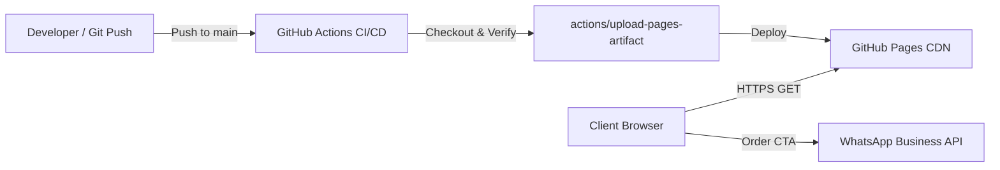

# Afri-KAD Market Landing Page

Production static landing page for **Afri-KAD Market | Prêt à Cuisiner** (Lomé, Togo), deployed via GitHub Pages.

---

## 1. System Architecture & Stack Overview

- **Frontend Core:** Pure HTML5 structure with semantic sections and interactive UX.
- **Styling & Design System:** Tailwind CSS (CDN runtime configuration) with custom brand tokens:
  - Font Families: `Plus Jakarta Sans` (sans-serif), `Playfair Display` (serif).
  - Brand Palette: Deep greens (`#15803D`, `#14532D`), vibrant accents (`#EA580C`, `#D97706`), and warm neutral tones (`#FFFBEB`, `#FAFAF9`).
- **Conversion Funnel:** Direct integration into WhatsApp business API endpoint (`wa.me/22893609997`) with pre-populated order contexts.
- **Hosting & CDN:** GitHub Pages edge network deployed via GitHub Actions CI/CD.



---

## 2. Directory Structure

```
afrikad-landing-page/
├── .github/
│   └── workflows/
│       └── deploy.yml          # Automated GitHub Pages CI/CD workflow
├── .agentignore                # AI context exclusion list
├── .geminiignore               # Antigravity/Gemini context exclusion list
├── .gitignore                  # Git version control ignore rules
├── AGENT.md                    # Agent memory, architectural decisions, and context
├── CHANGELOG.md                # SemVer-compliant version history
├── README.md                   # System documentation and operational runbook
└── index.html                  # Core production landing page application
```

---

## 3. Local Development Setup

No complex runtime dependencies or node build steps are required. The application can be served with any static web server.

### Prerequisites
- Python 3.x, Node.js (`npx`), or VS Code Live Server.

### Running Locally

Using Python 3 built-in HTTP server:
```bash
python3 -m http.server 8000
```

Using Node (`npx serve`):
```bash
npx serve .
```

Open `http://localhost:8000` in your browser.

---

## 4. Production Deployment

Deployments are fully automated via GitHub Actions on every push to the `main` branch.

### GitHub Pages Configuration
1. Navigate to **Settings > Pages** in the GitHub repository.
2. Under **Build and deployment > Source**, ensure **GitHub Actions** is selected.
3. Every push to `main` automatically triggers the `.github/workflows/deploy.yml` pipeline:
   - Validates repository contents.
   - Packages the static root directory.
   - Deploys to GitHub Pages edge CDN.

---

## 5. Environment Variable Reference

This application is an edge-served static client and requires no backend server environment variables.

| Variable | Type | Required | Default | Description |
| :--- | :--- | :--- | :--- | :--- |
| N/A | None | No | N/A | Static single-page application requiring no server secrets |
